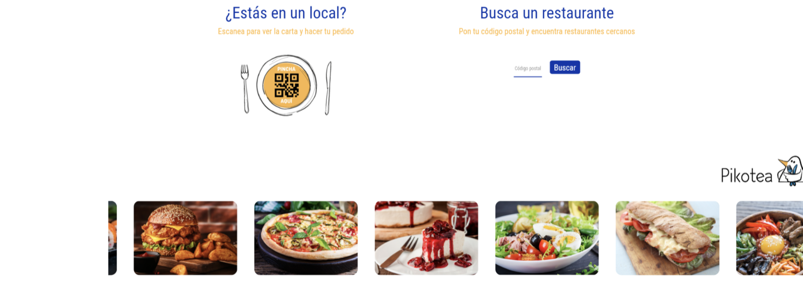
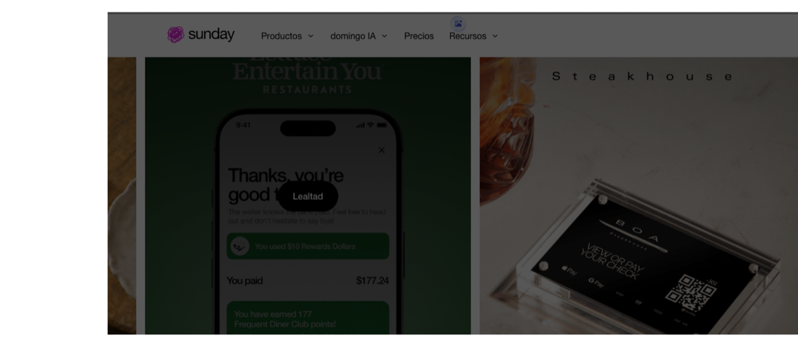

# PROYECTO FINAL DE CICLO / TFG: NOVANDA
## MEMORIA TÉCNICA Y DOCUMENTACIÓN OFICIAL DEL PROYECTO (v2.0)
### Módulo: Despliegue de Aplicaciones Web (DAWEB) — IES Fernando III

---

| Metadato | Detalle |
| :--- | :--- |
| **Proyecto** | **Novanda** — Sistema Interactivo de Gestión de Pedidos, Cartas Digitales y Comunicación de Sala y Cocina mediante Hardware Dedicado en Mesa |
| **Autor** | **Darío Caño Molina** (`dariocano2005@gmail.com`) |
| **Centro Docente** | **IES Fernando III** |
| **Ciclo Formativo** | Ciclo Formativo de Grado Superior en Desarrollo de Aplicaciones Web (DAW) |
| **Módulo** | Despliegue de Aplicaciones Web (DAWEB) |
| **Curso Académico** | 2025 / 2026 |
| **Versión del Documento** | **Versión 2.0 (Consolidada y Revisada con Retroalimentación Docente)** |
| **Repositorio GitHub** | [https://github.com/dariocano020/Novanda.git](https://github.com/dariocano020/Novanda.git) |

---

## Índice de Contenidos

1. [Resumen Ejecutivo del Proyecto](#1-resumen-ejecutivo-del-proyecto)
2. [Bloque I — Definición del Proyecto (Entregable Semana 1 - Revisado)](#2-bloque-i--definición-del-proyecto-entregable-semana-1---revisado)
   * 2.1. [Introducción y Contexto](#21-introducción-y-contexto)
   * 2.2. [Definición de la Idea y Propuesta de Valor](#22-definición-de-la-idea-y-propuesta-de-valor)
   * 2.3. [Objetivos del Proyecto](#23-objetivos-del-proyecto)
   * 2.4. [Alcance, Límites y Priorización MoSCoW (MVP vs Ampliaciones)](#24-alcance-límites-y-priorización-moscow-mvp-vs-ampliaciones)
   * 2.5. [Actores y Perfiles de Usuario: Matriz RBAC y Control de Comandas](#25-actores-y-perfiles-de-usuario-matriz-rbac-y-control-de-comandas)
   * 2.6. [Distinción entre Estado de Pedido Completo y Estado de Cada Plato](#26-distinción-entre-estado-de-pedido-completo-y-estado-de-cada-plato)
   * 2.7. [Solución Propuesta: Recorrido y Ciclo de Vida de una Comanda](#27-solución-propuesta-recorrido-y-ciclo-de-vida-de-una-comanda)
   * 2.8. [Aspecto Crítico a Vigilar: Arquitectura de Tiempo Real sin Recarga Manual](#28-aspecto-crítico-a-vigilar-arquitectura-de-tiempo-real-sin-recarga-manual)
   * 2.9. [Requisitos Funcionales y No Funcionales](#29-requisitos-funcionales-y-no-funcionales)
   * 2.10. [Planificación y Metodología Inicial](#210-planificación-y-metodología-inicial)
3. [Bloque II — Estado del Arte y Estudio de Mercado (Entregable Semana 2 - Revisado)](#3-bloque-ii--estado-del-arte-y-estudio-de-mercado-entregable-semana-2---revisado)
   * 3.1. [Objetivos del Estudio de Mercado](#31-objetivos-del-estudio-de-mercado)
   * 3.2. [Investigación de Aplicaciones Existentes](#32-investigación-de-aplicaciones-existentes)
     * 3.2.1. [Pikotea](#321-pikotea)
     * 3.2.2. [Sunday](#322-sunday)
     * 3.2.3. [Square para Restaurantes](#323-square-para-restaurantes)
   * 3.3. [Análisis de la Competencia y Pruebas Funcionales](#33-análisis-de-la-competencia-y-pruebas-funcionales)
   * 3.4. [Análisis DAFO de las Soluciones Existentes](#34-análisis-dafo-de-las-soluciones-existentes)
   * 3.5. [Análisis DAFO Propio de Novanda](#35-análisis-dafo-propio-de-novanda)
   * 3.6. [Oportunidad del Proyecto y Propuesta de Valor](#36-oportunidad-del-proyecto-y-propuesta-de-valor)
   * 3.7. [Validación Docente y Ajustes de Alcance (Feedback Profesor DAW)](#37-validación-docente-y-ajustes-de-alcance-feedback-profesor-daw)
   * 3.8. [Gestión de Tareas con Tablero Kanban (Semana 2)](#38-gestión-de-tareas-con-tablero-kanban-semana-2)
4. [Bloque III — Conclusiones y Próximos Pasos](#4-bloque-iii--conclusiones-y-próximos-pasos)
5. [Anexos y Estructura Documental del Repositorio](#5-anexos-y-estructura-documental-del-repositorio)

---

## 1. Resumen Ejecutivo del Proyecto

**Novanda** es una solución web para la hostelería diseñada para solventar la saturación y los tiempos muertos en salas de restaurantes y bares mediante la incorporación de **tablets táctiles dedicadas en cada mesa**, interconectadas en tiempo real con terminales de camareros y una pantalla KDS (*Kitchen Display System*) en cocina.

Frente a la fatiga generada por los códigos QR tradicionales que obligan al comensal a utilizar su teléfono móvil personal (*Bring Your Own Device - BYOD*), Novanda propone una experiencia accesible, visual y sin fricciones: la carta está permanentemente disponible en pantalla grande de 10 pulgadas, con modo oscuro de alto impacto visual, navegación fotográfica por categorías y una botonera fija para **Llamar al camarero** y **Pedir la cuenta** al instante.

El sistema se apoya en una arquitectura orientada a eventos en tiempo real mediante **WebSockets**, garantizando que la pantalla de cocina reciba y muestre las nuevas comandas y cambios de estado de manera reactiva e instantánea, **sin requerir recargas manuales de página (`F5`)**.

---

## 2. Bloque I — Definición del Proyecto (Entregable Semana 1 - Revisado)

### 2.1. Introducción y Contexto
El sector de la hostelería en España experimenta frecuentes cuellos de botella durante las horas punta. Tras el confinamiento de 2020 se extendió el uso de códigos QR en las mesas, pero la experiencia diaria ha demostrado múltiples inconvenientes:
* Falta de cobertura en interiores y terrazas.
* Agotamiento de la batería del dispositivo del cliente.
* Letras diminutas y PDFs pesados no adaptados a pantallas reducidas.
* Exclusión de la tercera edad o clientes no habituados al entorno digital.
* Pérdida de cercanía: el cliente sigue teniendo que buscar con la mirada al camarero para pedir una bebida extra o pedir la cuenta.

Novanda responde a esta necesidad ofreciendo una experiencia táctil compartida y fluida en la propia mesa.

### 2.2. Definición de la Idea y Propuesta de Valor
Novanda se basa en **tres pilares fundamentales**:
1. **Hardware Dedicado:** Tablets táctiles de 10" instaladas en mesa, siempre encendidas y con la carta lista para su consulta colectiva.
2. **Comunicación Inmediata de Sala:** Panel para camareros que recibe avisos de mesa con un solo toque ("Llamar camarero" o "Pedir la cuenta").
3. **Sincronización Directa con Cocina:** Pantalla KDS que organiza los pedidos cronológicamente, evitando notas de papel ilegibles y pérdidas de tiempo.

```
+-----------------------------------------------------------+
|               TABLET CLIENTE EN MESA                      |
|  - Carta interactiva en modo oscuro                       |
|  - Botones fijos: [Llamar Camarero] [Pedir la Cuenta]     |
+-----------------------------+-----------------------------+
                              |
              +---------------+---------------+
              |                               |
              v                               v
+-----------------------------+ +-----------------------------+
|    PANEL CAMARERO / SALA    | |    PANEL COCINA / KDS       |
|  - Alertas visuales de mesa | |  - Comandas cronológicas    |
|  - Control de avisos        | |  - Estados de preparación   |
+-----------------------------+ +-----------------------------+
```

### 2.3. Objetivos del Proyecto

#### Objetivo General
Diseñar, implementar y desplegar una plataforma web modular para establecimientos hosteleros que agilice la comunicación mesa-sala-cocina mediante tablets dedicadas, optimizando los tiempos de rotación y mejorando la satisfacción del cliente.

#### Objetivos Específicos
* Desarrollar una interfaz de comensal accesible, sin formularios de registro ni descargas.
* Proveer una botonera de llamada rápida permanentemente visible en la pantalla de mesa.
* Construir una pantalla KDS reactiva para el personal de cocina con actualización instantánea vía WebSockets.
* Desarrollar un panel de sala para la gestión de avisos, estados de mesa y platos listos para servir.
* Implementar un panel administrativo ligero para la gestión de cartas, platos, alérgenos y precios.
* Desplegar la solución mediante contenedores Docker y servidor web Nginx según los estándares del módulo DAWEB.

---

### 2.4. Alcance, Límites y Priorización MoSCoW (MVP vs Ampliaciones)

Para garantizar la viabilidad del proyecto durante el curso lectivo y enfocar el esfuerzo en demostrar un flujo principal completo, se estructura el alcance mediante la metodología **MoSCoW**:

```
┌────────────────────────────────────────────────────────────────────────┐
│                 PRIORIZACIÓN DEL ALCANCE (METODOLOGÍA MoSCoW)          │
├───────────────────────────────────┬────────────────────────────────────┤
│ 🟢 FASE 1: IMPRESCINDIBLES (MVP)   │ 🔵 FASE 2: AMPLIACIONES FUTURAS    │
│    (Must Have - Demostración)     │    (Could Have / Won't Have)       │
├───────────────────────────────────┼────────────────────────────────────┤
│ • Catálogo táctil modo oscuro     │ • Pasarela de cobro bancario en    │
│ • Carrito y envío de comanda      │   tablet con datáfono virtual      │
│ • Botón "Llamar Camarero"         │ • División de tickets entre varios │
│ • Botón "Pedir la Cuenta"         │   comensales (subcuentas por plato)│
│ • WebSockets en red local         │ • Modificadores avanzados complejos│
│ • Pantalla Cocina KDS reactiva    │   (puntos de cocción, extras)      │
│ • Panel de Sala para avisos       │ • Sistema de reservas anticipadas  │
│ • CRUD de platos y categorías     │ • Control automático de stock por  │
│ • Marcado de platos agotados      │   recetas e ingredientes unitarios │
│ • Despliegue Docker DAWEB         │ • Informes de analítica predictiva │
└───────────────────────────────────┴────────────────────────────────────┘
```

#### Funcionalidades Imprescindibles (MVP - Fase 1):
* **Módulo Mesa (Tablet):** Visualización fotográfica en modo oscuro, navegación táctil por categorías, confección de comanda en borrador y confirmación de envío.
* **Botonera Directa:** Acciones persistentes de *"Llamar Camarero"* y *"Pedir la Cuenta"* en la pantalla de mesa.
* **Módulo Cocina (KDS Reactivo):** Recepción instantánea de comandas por WebSockets en red local sin recargar la página, organización por orden cronológico y cambio de estado de platos individuales.
* **Módulo Sala (Camareros):** Panel web con semáforo de mesas, recepción de alertas de llamada, avisos de cuenta solicitada y notificación de platos listos en pase.
* **Módulo Gestión / Admin:** CRUD esencial de platos, categorías, fotos, precios, alérgenos y marcado rápido de platos agotados.
* **Infraestructura de Despliegue:** Contenedorización completa con Docker y orquestación con Docker Compose bajo servidor Nginx.

#### Funcionalidades Pospuestas para Ampliaciones (Fase 2):
* **Pasarela de pago online en mesa:** Se descarta en MVP para no imponer comisiones bancarias al hostelero ni asumir requerimientos de seguridad PCI-DSS.
* **División matemática de tickets:** Pospuesta para evitar retrasos en el flujo principal.
* **Gestión contable / fiscal (ERP):** El sistema convive con el TPV o software de caja existente sin pretender sustituirlo.
* **Integración con agregadores de delivery (Glovo, Just Eat):** Fuera del alcance del servicio *in situ*.

---

### 2.5. Actores y Perfiles de Usuario: Matriz RBAC y Control de Comandas

Para resolver las ambigüedades operativas y cumplir con los estándares de diseño de DAW, se define la matriz de control de acceso basado en roles (RBAC) y las reglas de gestión de comandas:

| Operación sobre la Comanda | Comensal (Tablet Mesa) | Camarero (Personal Sala) | Cocinero (Cocina KDS) | Administrador / Gerente |
| :--- | :---: | :---: | :---: | :---: |
| **Consultar Carta y Alérgenos** | ✅ Sí | ✅ Sí | ✅ Sí | ✅ Sí |
| **Crear Comanda (Borrador local)** | ✅ Sí (Solo su mesa) | ✅ Sí (Cualquier mesa) | ❌ No | ✅ Sí (Auditoría) |
| **Confirmar y Enviar Comanda** | ✅ Sí (Solo su mesa) | ✅ Sí | ❌ No | ✅ Sí |
| **Consultar Estado de Comanda** | ✅ Sí (Solo su mesa) | ✅ Sí (Todas las mesas)| ✅ Sí (Cola KDS) | ✅ Sí (Histórico global) |
| **Modificar Comanda Enviada** | ❌ No (Bloqueado) | ✅ Sí (Con mediación) | ❌ No | ✅ Sí |
| **Cancelar Comanda Completa** | ❌ No | ✅ Sí (Motivo requerido) | ❌ No | ✅ Sí (Permiso total) |
| **Cancelar Plato Individual** | ❌ No | ✅ Sí (Justificado) | ✅ Sí (Por fin de stock) | ✅ Sí |
| **Cambiar Estado de Plato (KDS)** | ❌ No | ❌ No | ✅ Sí (Marchando/Listo) | ✅ Sí |
| **Marcar Plato como Servido** | ❌ No | ✅ Sí (En sala) | ❌ No | ✅ Sí |
| **Solicitar Cuenta** | ✅ Sí (Botón directo) | ✅ Sí (En nombre de mesa) | ❌ No | ❌ No |
| **Cobrar y Cerrar Pedido** | ❌ No | ✅ Sí (Libera mesa) | ❌ No | ✅ Sí |
| **CRUD Catálogo y Precios** | ❌ No | ❌ No | ❌ No | ✅ Sí |

#### Políticas de Negocio y Seguridad:
1. **Inmutabilidad de la comanda para el comensal tras el envío:** Una vez confirmada la comanda, el comensal no puede editar ni cancelar platos desde la tablet. Esto evita cancelaciones maliciosas de comida que ya se encuentre en el fuego o duplicidades de platos. Si el cliente desea rectificar, debe pulsar *"Llamar Camarero"*, actuando el personal de sala como validador humano.
2. **Auditoría de cancelaciones en sala:** Cada cancelación realizada por el camarero queda registrada en el sistema con identificador de empleado, hora y motivo estandarizado (*"Error de cliente"*, *"Alergia sobrevenida"*, *"Plato demorado"*).
3. **Rol de cocina enfocado en producción:** El cocinero no interviene en cobros ni cancelaciones monetarias, pero tiene la facultad de marcar un plato como `AGOTADO` cuando se termina una preparación, informando de inmediato a sala y a las tablets de mesa.

---

### 2.6. Distinción entre Estado de Pedido Completo y Estado de Cada Plato

Para modelar con exactitud el ritmo asíncrono de un restaurante (donde bebidas y entrantes salen mucho antes que segundos platos o postres), Novanda desacopla formalmente dos niveles de estados:

```
┌────────────────────────────────────────────────────────────────────────┐
│                    NIVEL 1: ESTADO DEL PEDIDO COMPLETO                 │
│                                (Order)                                 │
└───────────────────────────────────┬────────────────────────────────────┘
                                    │ Contiene 1..N
                                    ▼
┌────────────────────────────────────────────────────────────────────────┐
│                  NIVEL 2: ESTADO DE CADA PLATO / LÍNEA                 │
│                              (OrderItem)                               │
└────────────────────────────────────────────────────────────────────────┘
```

#### Estados del Pedido Completo (`Order`):
* `BORRADOR` (*Draft*): Platos en la cesta de la tablet antes de pulsar confirmación.
* `RECIBIDO` (*Submitted*): Registrado en BD y difundido reactivamente a cocina y sala.
* `EN_PREPARACION` (*In Progress*): Al menos uno de sus platos ha empezado a elaborarse.
* `PARCIALMENTE_LISTO` (*Partially Ready*): Algunos platos están en el pase de salida mientras otros continúan en cocina.
* `LISTO_PARA_SERVIR` (*Ready to Serve*): Todos los platos de la orden están terminados en cocina.
* `SERVIDO` (*Delivered*): Todos los platos han sido entregados en la mesa física.
* `CUENTA_SOLICITADA` (*Bill Requested*): Solicitud de cobro activada por el comensal.
* `CERRADO_PAGADO` (*Paid / Closed*): Cobro completado por el camarero; mesa liberada y reseteada.
* `CANCELADO` (*Cancelled*): Orden anulada por el personal autorizado.

#### Estados de cada Plato individual (`OrderItem`):
* `PENDIENTE` (*Pending*): En cola de cocina, a la espera de ser tomado por una partida.
* `EN_MARCHA` (*Cooking*): El cocinero ha iniciado su preparación.
* `LISTO` (*Ready*): Emplatado en el pase caliente/frío; emite aviso a los camareros.
* `SERVIDO` (*Served*): Entregado en mesa por el personal de sala.
* `CANCELADO` (*Cancelled*): Anulado por sala o marcado como no disponible por cocina.

#### Tabla de Transición y Sincronización Automática:

| Condición de los Platos (`OrderItem`) | Estado Resultante del Pedido (`Order`) |
| :--- | :--- |
| Todos los platos en estado `PENDIENTE` | `RECIBIDO` |
| Al menos un plato en `EN_MARCHA` y ninguno en `LISTO` | `EN_PREPARACION` |
| Al menos un plato en `LISTO` y otros en `PENDIENTE` o `EN_MARCHA` | `PARCIALMENTE_LISTO` |
| Todos los platos válidos están en `LISTO` o `SERVIDO` (mínimo 1 en `LISTO`) | `LISTO_PARA_SERVIR` |
| Todos los platos válidos han sido marcados como `SERVIDO` | `SERVIDO` |
| Todos los platos han sido marcados como `CANCELADO` | `CANCELADO` |

---

### 2.7. Solución Propuesta: Recorrido y Ciclo de Vida de una Comanda

El recorrido de una comanda desde su gestación hasta el cierre se compone de 8 fases operativas consecutivas:

```
┌────────────────────────────────────────────────────────────────────────┐
│                   CICLO DE VIDA COMPLETO DE UNA COMANDA                │
└────────────────────────────────────────────────────────────────────────┘

 [1. Mesa Activa] ──> Comensales eligen platos en Tablet
         │
         ▼
 [2. Cesta Borrador] ──> Comensal pulsa "Confirmar Pedido"
         │
         ▼
 [3. Persistencia y Emisión] ──> API guarda comanda en BD y emite evento WebSocket
         │
         ├─── (Sin recargar pantalla) ────────────────────────┐
         ▼                                                    ▼
 [4. Pantalla KDS Cocina]                             [Panel Camarero Sala]
     • Añade tarjeta con aviso sonoro                     • Mesa marcada con comanda activa
     • Estado: RECIBIDO / Platos: PENDIENTE
         │
         ▼
 [5. Elaboración en Partidas] ──> Cocinero marca platos a EN_MARCHA
         │                        Al emplatar, marca a LISTO
         ▼
 [6. Pase y Servicio] ──> Camarero recibe aviso de "Plato Listo"
         │                Recoge del pase y sirve en mesa (Estado: SERVIDO)
         ▼
 [7. Solicitud de Cuenta] ──> Comensal pulsa botón "Pedir la Cuenta" en Tablet
         │                    Camarero acude a la mesa con datáfono o cambio
         ▼
 [8. Cierre y Cobro] ──> Camarero valida cobro en su panel
                         Comanda pasa a CERRADO_PAGADO
                         Mesa se libera y la Tablet se resetea a pantalla inicial
```

#### Recorrido Paso a Paso:
1. **Apertura de Mesa:** La tablet muestra la bienvenida y la carta interactiva. Los comensales añaden platos al carrito (estado local `BORRADOR`).
2. **Envío de Comanda:** El comensal revisa los platos y pulsa *"Confirmar Pedido"*.
3. **Persistencia y Emisión:** El servidor procesa la petición HTTP `POST /api/orders` en una transacción segura de base de datos y emite de inmediato un evento WebSocket `order:new` a los canales suscritos.
4. **Recepción Reactiva en Cocina y Sala:** Sin recargar la página (`0` pulsaciones de F5), la pantalla KDS reproduce una alerta sonora y añade la tarjeta del pedido. El panel de sala refleja la mesa con comanda activa.
5. **Preparación y Pase:** Los cocineros pulsan sobre los platos para marcar `EN_MARCHA`. Al finalizar la preparación, pulsan `LISTO` y colocan el plato en el pase.
6. **Servicio en Sala:** El panel del camarero notifica *"Mesa X: platos listos para servir"*. El camarero sirve los platos y los marca como `SERVIDO`.
7. **Petición de Cuenta:** El comensal pulsa en la tablet *"Pedir la Cuenta"*, notificando al camarero en tiempo real.
8. **Cierre y Cobro:** El camarero efectúa el cobro por el método habitual del restaurante (datáfono o efectivo), confirma el cobro en su panel, la orden pasa a `CERRADO_PAGADO` y la tablet de mesa vuelve a su pantalla de bienvenida inicial.

---

### 2.8. Aspecto Crítico a Vigilar: Arquitectura de Tiempo Real sin Recarga Manual

Tal como se enfatiza en la revisión técnica del profesor, **no basta con almacenar el pedido en la base de datos**. Un sistema donde los cocineros deban pulsar `F5` para descubrir nuevos pedidos resulta inoperante y generaría fallos críticos durante el servicio.

Novanda resuelve este reto mediante una **arquitectura orientada a eventos reactivos con WebSockets**:

```
┌────────────────────────────────────────────────────────────────────────┐
│             ARQUITECTURA DE EVENTOS EN TIEMPO REAL (WEBSOCKETS)        │
└────────────────────────────────────────────────────────────────────────┘

    [TABLET MESA 3]                                [BACKEND NODE/EXPRESS]
           │                                                  │
           │ 1. POST /api/orders (Crear Comanda)              │
           ├─────────────────────────────────────────────────>│
           │                                                  │──> Guarda en BD
           │                                                  │    (Transacción ACID)
           │                                                  │
           │                                                  │ 2. Emite evento WebSocket
           │                                                  │    io.to("kitchen").emit("order:new")
           │                                                  ├───────────────┐
           │                                                  │               │
           │                                                  ▼               ▼
                                                  [PANTALLA KDS COCINA]  [PANEL CAMARERO]
                                                  • Recibe socket 'order:new'
                                                  • Inyecta tarjeta en DOM
                                                  • Emite aviso sonoro (Bip)
                                                  • 0 recargas manuales (No F5)
```

#### Especificación de Reactividad y Resiliencia:
* **Canales y Salas Dedicadas:** Servidor WebSocket con canales separados (`kitchen`, `waiters`, `table:{id}`) para optimizar el tráfico de red.
* **Manipulación Reactiva del DOM:** El frontend KDS captura el evento `order:new`, actualiza su estado interno reactivo e inyecta la tarjeta en pantalla sin alterar la navegación ni interrumpir el trabajo de los cocineros.
* **Alertas Multisensoriales:** Emisión de un sonido nítido (Web Audio API) y animación de pulso visual de color para avisar al personal aunque se encuentre de espaldas a la pantalla.
* **Detección de Desconexión y Reconexión Automática:** Monitorización continua mediante *heartbeat* (ping/pong). Si la red Wi-Fi local cae brevemente, el sistema se reconecta automáticamente y sincroniza el estado pendiente con el backend mediante `GET /api/orders/active` para impedir pérdidas de información.

---

### 2.9. Requisitos Funcionales y No Funcionales

#### Requisitos Funcionales Actualizados:
* **RF-01 (Carta Visual):** Navegación táctil e intuitiva por categorías en tablet en modo oscuro.
* **RF-02 (Ficha de Plato):** Presentación fotográfica, ingredientes, alérgenos obligatorios y precio.
* **RF-03 (Acción Rápida - Llamar Camarero):** Botón flotante permanente que emite notificación inmediata al panel de sala.
* **RF-04 (Acción Rápida - Pedir Cuenta):** Botón flotante permanente que emite aviso de solicitud de factura.
* **RF-05 (Cesta y Confirmación):** Cesta local en tablet con confirmación comensal y posterior bloqueo de edición.
* **RF-06 (Recepción KDS sin Recarga):** Inyección reactiva automática de comandas en cocina sin F5 mediante WebSockets.
* **RF-07 (Gestión Granular de Estados):** Transición independiente de platos (`PENDIENTE` $\rightarrow$ `EN_MARCHA` $\rightarrow$ `LISTO` $\rightarrow$ `SERVIDO`) y sincronización automática del pedido.
* **RF-08 (Gestión de Stock Inmediata):** Marcado de platos agotados con reflejo instantáneo en las tablets de mesa.
* **RF-09 (Panel Camarero Reactivo):** Vista de sala con semáforo de mesas, llamadas activas y platos listos para servir.
* **RF-10 (CRUD Administrativo):** Mantenimiento de catálogo de platos, precios, alérgenos y categorías.

#### Requisitos No Funcionales Actualizados:
* **RNF-01 (Reactividad en Tiempo Real):** Latencia en la llegada de comandas a cocina inferior a 300 ms en red local.
* **RNF-02 (Cero Recargas Manuales):** Funcionamiento continuo de las pantallas de sala y cocina sin recargas de página.
* **RNF-03 (Usabilidad Táctil Universal):** Diseño táctil adaptado a pantallas de 10 pulgadas con áreas de pulsación mínimas de 48x48 px, utilizable por cualquier rango de edad.
* **RNF-04 (Tolerancia a Fallos en Red Local):** Operatividad plena en la intranet del restaurante y reconexión automática en microcortes Wi-Fi.
* **RNF-05 (Despliegue DAWEB):** Empaquetado completo en contenedores Docker gestionados mediante Docker Compose y proxy inverso Nginx.

---

### 2.10. Planificación y Metodología Inicial
Adopción del marco ágil **Kanban** organizado en iteraciones semanales orientadas a los hitos de DAWEB, con control de versiones en GitHub.

---

## 3. Bloque II — Estado del Arte y Estudio de Mercado (Entregable Semana 2 - Revisado)

### 3.1. Objetivos del Estudio de Mercado
En esta segunda semana se investigan las herramientas que resuelven problemas similares en hostelería, analizando su funcionamiento, fortalezas, puntos débiles y vacíos no cubiertos para validar de forma razonada la propuesta de Novanda.

### 3.2. Investigación de Aplicaciones Existentes

#### 3.2.1. Pikotea
* **Sitio Web:** [pikotea.com](https://pikotea.com) | **Empresa:** Pikotea Software S.L.
* **Público:** Restaurantes, bares y comensales.
* **Problema que aborda:** La desconexión entre la toma de comandas en sala, la cocina y la caja registradora.
* **Funcionalidades:** Carta digital QR, autopedidos desde el móvil, TPV propio, pantalla KDS de cocina e informes de gestión.
* **Modelo económico:** De pago (SaaS con suscripción mensual modulable).
* **Otros productos:** Kioscos tipo tótem de autoservicio y módulo para delivery/take-away.

#### 3.2.2. Sunday
* **Sitio Web:** [sundayapp.com](https://sundayapp.com) | **Empresa:** Sunday Technologies SAS.
* **Público:** Comensales y personal de sala.
* **Problema que aborda:** Las esperas prolongadas al pedir la cuenta y las complicaciones al dividir importes entre varios comensales.
* **Funcionalidades:** Escaneo de QR en mesa, visualización de cuenta, división inteligente del ticket (por comensal o por plato), pago exprés mediante Apple Pay y Google Pay, propinas digitales y factura electrónica.
* **Modelo económico:** Mixto (comisión porcentual por cobro procesado + planes de suscripción para funciones avanzadas).
* **Otros productos:** Conectores con los principales TPVs de mercado (Micros, Agora, etc.).

#### 3.2.3. Square para Restaurantes
* **Sitio Web:** [squareup.com/es/es/point-of-sale/restaurants](https://squareup.com/es/es/point-of-sale/restaurants) | **Empresa:** Block, Inc. (Square).
* **Público:** Negocios de hostelería de todos los tamaños.
* **Problema que aborda:** La dispersión provocada por utilizar software desconectado para cobros, pedidos, inventario y gestión de empleados.
* **Funcionalidades:** Planos interactivos de sala, pedidos QR comensal, KDS de cocina, gestión de turnos de personal y control automatizado de stock.
* **Modelo económico:** Mixto (plan básico sin mensualidad con comisiones por cobro + planes mensuales "Plus").
* **Otros productos:** Hardware de cobro propietario (datáfonos *Square Terminal*, *Square Register*), software de nóminas y herramientas de marketing.

### 3.3. Análisis de la Competencia y Pruebas Funcionales
Durante las pruebas con estas soluciones se han evidenciado patrones y dificultades de uso:
1. **Flujos de Pedido y Navegación:** Las cartas de Pikotea y Sunday son visualmente atractivas, pero el modelo BYOD (teléfono móvil personal) expone al comensal a interrupciones, falta de batería y mala cobertura dentro del local.
2. **Registro y Accesibilidad:** Ambas prescinden del registro previo obligatorio, pero sus interfaces no están concebidas para pantallas compartidas en mesa ni resultan accesibles para la tercera edad.


*Figura 1: Interfaz de Pikotea. Destaca su estética visual de platos, pero muestra la dependencia del escaneo de QR en el smartphone personal del cliente.*


*Figura 2: Interfaz de Sunday. Muestra el enfoque centrado en pago exprés comensal y terminales de apoyo.*

### 3.4. Análisis DAFO de las Soluciones Existentes
* **Pikotea:** Fuerte arraigo en normativa española; curva de aprendizaje elevada en su administración y riesgo ante agregadores de delivery subvencionados.
* **Sunday:** Rapidez sobresaliente en el cobro con Apple/Google Pay; vulnerabilidad por dependencia absoluta del smartphone y recelo ante fraudes por manipulación de pegatinas QR (*quishing*).
* **Square para Restaurantes:** Ecosistema sumamente robusto y completo; sin embargo, resulta sobredimensionado y financieramente gravoso para establecimientos pequeños.

### 3.5. Análisis DAFO Propio de Novanda

| Dimensión | Análisis para el Proyecto Novanda |
| :--- | :--- |
| **Fortalezas (F)** | • Hardware dedicado en mesa: siempre encendido y accesible sin usar el móvil propio.<br>• Botonera fija de acciones rápidas ("Llamar Camarero" y "Pedir Cuenta").<br>• Interfaz en modo oscuro con alta legibilidad para cualquier grupo demográfico.<br>• Sin descargas obligatorias ni intermediación financiera abusiva.<br>• Sincronización en tiempo real comensal-sala-cocina mediante WebSockets sin recarga manual. |
| **Debilidades (D)** | • Inversión inicial en tablets de 10" y soportes de seguridad por parte del local.<br>• Necesidad de protocolo de carga electrificada en mesas.<br>• Proyecto en fase inicial frente a proveedores con trayectoria comercial extendida. |
| **Oportunidades (O)** | • Fatiga y malestar de los clientes ante los códigos QR móviles.<br>• Cuellos de botella en locales medianos que no pueden costear un ERP corporativo.<br>• Progresivo abaratamiento de tablets Android comerciales en el mercado.<br>• Hosteleros que desean agilidad en sala sin cambiar su software de caja habitual. |
| **Amenazas (A)** | • Reticencia al cambio tecnológico en perfiles hosteleros tradicionales.<br>• Riesgo de roturas accidentales de pantallas en mesas con alta rotación o fiestas.<br>• Grandes competidores que regalan software a cambio de comisiones por cobro. |

### 3.6. Oportunidad del Proyecto y Propuesta de Valor
* **Necesidad detectada:** El software comercial prioriza la administración contable por encima de la comodidad directa del comensal y la agilidad de la comunicación no verbal en mesa.
* **Limitación común:** La absoluta dependencia del smartphone del cliente mediante QR, con sus consiguientes barreras de batería, conectividad y exclusión visual.
* **Aporte diferencial de Novanda:** Hardware táctil en mesa con botonera fija de llamadas, diseño en modo oscuro adaptado a pantallas de 10 pulgadas y sincronización bidireccional inmediata en red local.

---

### 3.7. Validación Docente y Ajustes de Alcance (Feedback Profesor DAW)

Tras la revisión formal de la propuesta de proyecto por parte del profesor tutor del ciclo, se recibió el siguiente dictamen favorable:

> **"La propuesta es sólida y tiene potencial suficiente para un proyecto de fin de ciclo de DAW."**

Para elevar al máximo nivel la calidad técnica de la memoria, se han incorporado punto por punto las cuatro recomendaciones docentes:

1. **Usuarios y roles:** Se ha integrado la matriz de permisos RBAC detallada (apartado 2.5), clarificando que el comensal no puede editar ni anular comandas confirmadas (debe mediar el camarero), y atribuyendo al cocinero el control exclusivo de estados de cocina y avisos de platos agotados.
2. **Distinción de estados:** Se ha disociado formalmente el estado del pedido completo (`Order`) del estado individual de cada plato (`OrderItem`) en el apartado 2.6, permitiendo gestionar los distintos ritmos de elaboración en cocina con una tabla de sincronización automática.
3. **Priorización de funcionalidades:** Se ha delimitado en el apartado 2.4 el conjunto de requisitos imprescindibles (MVP - Fase 1) bajo metodología MoSCoW, asegurando la demostración del flujo principal completo sin sobrecargar el desarrollo con módulos secundarios (pasarelas de pago, división de tickets).
4. **Recorrido de la comanda:** Se ha descrito y diagramado el ciclo de vida completo en 8 etapas (apartado 2.7), cubriendo desde la selección en mesa hasta el servicio, cobro y liberación física de la mesa.
5. **Vigilancia del tiempo real:** Se ha formalizado en el apartado 2.8 la arquitectura reactiva basada en WebSockets y manipulación del DOM en el KDS de cocina, descartando el *polling* HTTP tradicional y garantizando la llegada de comandas con aviso acústico y visual **sin necesidad de recargar manualmente la página (`F5`)**.

---

### 3.8. Gestión de Tareas con Tablero Kanban (Semana 2)
Todas las actividades planificadas para el estudio de mercado y la integración de las recomendaciones docentes se han completado y documentado en el [Tablero Kanban](docs/kanban/Tablero_Kanban.md):
* [x] Búsqueda y análisis de 3 plataformas del sector (Pikotea, Sunday, Square).
* [x] Elaboración de matrices DAFO comparativas y DAFO propio de Novanda.
* [x] Justificación razonada de la propuesta de valor y oportunidad de mercado.
* [x] Definición de la matriz de permisos y reglas de modificación de comandas.
* [x] Modelado de la distinción entre estado de comanda y estado de platos individuales.
* [x] Priorización MoSCoW del MVP frente a ampliaciones futuras.
* [x] Especificación del recorrido integral de una comanda en 8 etapas.
* [x] Diseño arquitectónico del sistema en tiempo real con WebSockets para pantalla KDS.
* [x] Redacción y consolidación de la documentación técnica v2.0 en GitHub.

---

## 4. Bloque III — Conclusiones y Próximos Pasos

El estudio de mercado y la retroalimentación docente de la Semana 2 ratifican plenamente la viabilidad, pertinencia y solidez académica del proyecto Novanda. El hardware dedicado en mesa junto con una sincronización reactiva en tiempo real sin recarga manual cubre con solvencia un vacío desatendido por las herramientas comerciales.

**Próximos pasos para las Semanas 3 en adelante:**
1. Diseño de los *wireframes* y prototipos interactivos en Figma para la tablet de mesa, el panel de sala y el KDS de cocina.
2. Definición formal del modelo entidad-relación y script DDL de la base de datos (tablas `orders`, `order_items`, `dishes`, `categories`, `tables`, `users`).
3. Configuración del entorno contenerizado en Docker con Docker Compose y Nginx (módulo DAWEB).
4. Desarrollo de la API REST y del servidor de eventos WebSockets en backend.
5. Implementación del cliente reactivo KDS con avisos sonoros y recepción automática de comandas.

---

## 5. Anexos y Estructura Documental del Repositorio

* `MEMORIA.md`: Este documento maestro consolidado (versiones v1 y v2 revisadas).
* `docs/memoria/Memoria_Novanda_v1.md`: Memoria original de la Semana 1.
* `docs/memoria/Memoria_Novanda_v2.md`: Memoria oficial de la Semana 2 con análisis de sector y especificación técnica mejorada.
* `docs/kanban/Tablero_Kanban.md`: Tablero de gestión ágil de tareas actualizado.
* `docs/capturas/`: Evidencias visuales de la investigación (`captura_pikotea.png`, `captura_sunday.png`).
* `docs/referencia/`: Pauta académica oficial de la asignatura (`Semana_2_Analisis_del_Sector.pdf`).
