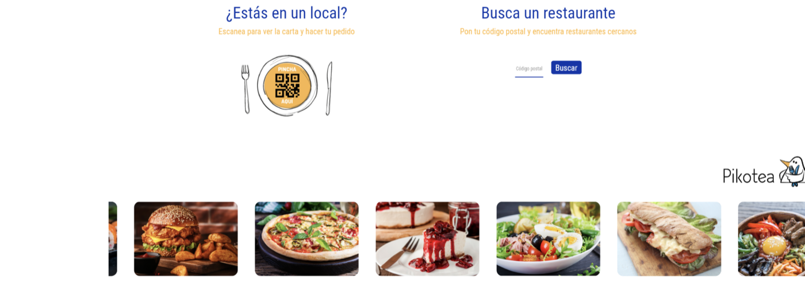
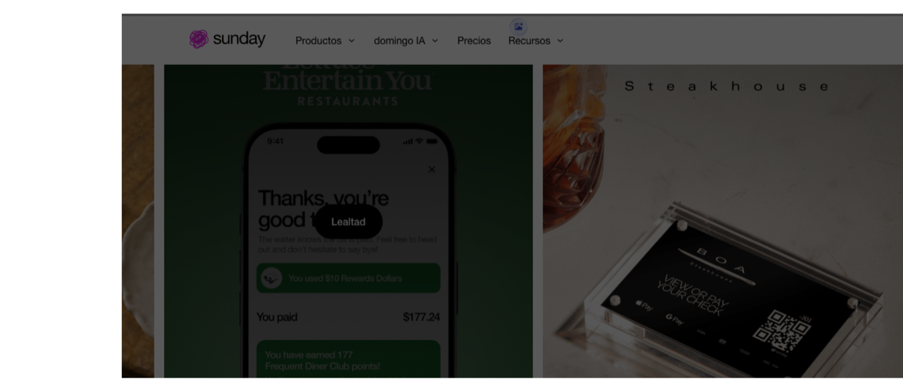

# MEMORIA DEL PROYECTO: NOVANDA (Versión 2.0)
## Semana 2 — Análisis del Sector y Estudio de Mercado
### Apartado: Estado del Arte y Aplicaciones Existentes

---

### Datos del Proyecto y Autoría
* **Proyecto:** Novanda — Sistema Interactivo de Pedidos y Comunicación en Mesa para Hostelería
* **Autor:** Darío Caño Molina
* **Centro Educativo:** IES Fernando III
* **Ciclo Formativo:** Ciclo Formativo de Grado Superior en Desarrollo de Aplicaciones Web (DAW)
* **Módulo Profesional:** Despliegue de Aplicaciones Web (DAWEB)
* **Curso Académico:** 2025 / 2026
* **Versión del Documento:** v2.0 (Entregable Semana 2)
* **Repositorio Oficial:** [https://github.com/dariocano020/Novanda.git](https://github.com/dariocano020/Novanda.git)

---

## 1. Introducción a la Semana 2

Tras definir en la Semana 1 la idea inicial y los objetivos de **Novanda**, el propósito de esta segunda semana es realizar un estudio exhaustivo del mercado y del estado del arte tecnológico en el sector de la hostelería.

El objetivo no es crear una aplicación simplemente porque la idea resulte atractiva, sino **entender qué necesidad real cubre**, cómo resuelven actualmente este problema las soluciones líderes del mercado, qué hacen bien, qué limitaciones presentan y **por qué tiene pleno sentido desarrollar nuestra propia solución**.

En este documento se responde a cuatro cuestiones fundamentales:
1. ¿Qué aplicaciones existen que resuelven un problema parecido?
2. ¿Qué hacen bien y qué limitaciones técnicas y funcionales tienen?
3. ¿Qué necesidades reales del comensal y del hostelero siguen sin estar suficientemente cubiertas?
4. ¿Qué aporta y cómo se diferencia **Novanda** frente a la oferta actual?

---

## 2. Estado del Arte y Aplicaciones Existentes

Se ha llevado a cabo una investigación profunda sobre tres plataformas representativas en el ámbito de la digitalización hostelera, abarcando desde soluciones de carta y comanda móvil (Pikotea y Sunday) hasta ecosistemas integrales de TPV y punto de venta (Square para Restaurantes).

```
┌────────────────────────────────────────────────────────────────────────┐
│                        MAPA DEL ESTADO DEL ARTE                        │
├──────────────────┬──────────────────┬──────────────────────────────────┤
│    PIKOTEA       │     SUNDAY       │      SQUARE RESTAURANTES         │
│  (pikotea.com)   │ (sundayapp.com)  │ (squareup.com/es/es/point-of-sale│
├──────────────────┼──────────────────┼──────────────────────────────────┤
│ Enfoque:         │ Enfoque:         │ Enfoque:                         │
│ Carta digital,   │ Pago rápido com- │ Ecosistema completo de TPV,     │
│ autocomandas QR  │ ensal vía móvil, │ hardware propietario (datáfonos) │
│ y TPV integrado. │ división cuenta. │ y gestión de personal/inventario.│
│ Modelo: SaaS     │ Modelo: Comisión │ Modelo: Mixto (Gratuito + Plus + │
│ por módulos.     │ + Suscripción.   │ comisiones por transacción).     │
└──────────────────┴──────────────────┴──────────────────────────────────┘
```

---

### 2.1. Aplicación 1: Pikotea

* **Enlace web:** [https://pikotea.com](https://pikotea.com)
* **Empresa responsable:** Pikotea Software S.L. (España)
* **Usuarios a los que se dirige:** Restaurantes, bares, cafeterías, locales de ocio nocturno y sus comensales.
* **Problema que intenta resolver:** La desconexión y desincronización entre la toma de pedidos en sala, la preparación en cocina y el sistema de cobro en caja, factores que provocan retrasos y tiempos muertos durante las horas de servicio.
* **Principales funcionalidades:**
  * Carta digital interactiva accesible por escaneo de código QR.
  * Autopedidos desde la propia mesa (*autocomandas*) realizados con el smartphone del comensal.
  * TPV integrado en la nube para el personal del local.
  * Pantallas de visualización de comandas para cocina (*Kitchen Display System* - KDS).
  * Informes de ventas y estadísticas de rotación de platos.
* **Modelo de negocio:** De pago bajo modelo Software as a Service (SaaS), estructurado en cuotas de suscripción mensual/anual en función de los módulos contratados por el establecimiento.
* **Otras soluciones o productos ofrecidos:** Kioscos físicos de autopedido tipo tótem para establecimientos de comida rápida (*fast food*) y pasarelas de gestión para servicios de *take away* y *delivery*.

---

### 2.2. Aplicación 2: Sunday

* **Enlace web:** [https://sundayapp.com](https://sundayapp.com)
* **Empresa responsable:** Sunday Technologies SAS (Francia / Internacional)
* **Usuarios a los que se dirige:** Comensales de hostelería casual y personal de sala.
* **Problema que intenta resolver:** Los prolongados tiempos de espera generados al final del servicio cuando múltiples mesas solicitan simultáneamente la cuenta al camarero, así como las molestias al calcular y dividir los importes entre varios comensales.
* **Principales funcionalidades:**
  * Escaneo de código QR colocado en la mesa física para abrir la cuenta en el navegador del teléfono.
  * Visualización detallada de los platos consumidos y toma de pedidos en versiones ampliadas.
  * División inteligente del ticket: división equitativa, pago individual por plato consumido o pago del importe restante.
  * Pasarela de pago exprés compatible con Apple Pay, Google Pay y tarjetas bancarias en menos de 10 segundos.
  * Posibilidad de añadir propina sugerida y recibir la factura por correo electrónico.
* **Modelo de negocio:** Modelo mixto; cobran una comisión porcentual por cada transacción económica procesada a través de su pasarela, junto con planes de suscripción para funcionalidades avanzadas de fidelización e integración.
* **Otras soluciones o productos ofrecidos:** Conectores e integraciones directas con sistemas de TPV tradicionales del mercado (Lightspeed, Micros, Agora, etc.).

---

### 2.3. Aplicación 3: Square para Restaurantes

* **Enlace web:** [https://squareup.com/es/es/point-of-sale/restaurants](https://squareup.com/es/es/point-of-sale/restaurants)
* **Empresa responsable:** Block, Inc. (Square)
* **Usuarios a los que se dirige:** Negocios de hostelería de todos los tamaños, desde cafeterías independientes hasta grandes franquicias y cadenas multi-local.
* **Problema que intenta resolver:** La fragmentación y dispersión provocada por utilizar múltiples herramientas independientes y no comunicadas para cobrar, gestionar pedidos, controlar el inventario y organizar los turnos del personal.
* **Principales funcionalidades:**
  * Gestión avanzada de mesas y diseño de planos de sala interactivos en tiempo real.
  * Pedidos y pagos en mesa mediante códigos QR para móviles de clientes.
  * Sistema KDS de cocina para la coordinación ágil de partidas de cocina.
  * Control horario de empleados, turnos, fichajes y permisos por roles.
  * Gestión centralizada de stock con aviso automático de ingredientes agotados.
* **Modelo de negocio:** Modelo mixto; ofrece un plan básico sin cuota mensual fija (con comisiones por transacción con tarjeta) y planes avanzados ("Plus" y "Premium") con tarifas mensuales fijas por terminal.
* **Otras soluciones o productos ofrecidos:** Venta y alquiler de datáfonos físicos propios (*Square Reader*, *Square Terminal*, *Square Register*), software de gestión de nóminas, tarjetas regalo y herramientas de marketing automatizado.

---

## 3. Análisis de la Competencia y Pruebas Funcionales

Durante la investigación se probaron y evaluaron los flujos de interacción de estas plataformas, identificando patrones de diseño efectivos, cuellos de botella e inconvenientes de usabilidad.

### 3.1. Consulta de Servicios y Realización de Pedidos
* **Flujo visual:** En herramientas como **Sunday** y **Pikotea**, la carta digital cuenta con una navegación atractiva y la acción de agregar platos a la cesta es intuitiva. Los tiempos de carga son adecuados cuando la conexión de datos es óptima.
* **Problema del modelo BYOD (*Bring Your Own Device*):** El usuario depende al 100% de la batería de su propio teléfono inteligente y de la cobertura 4G/5G en el interior del restaurante (donde muchas veces la señal es deficiente o la red Wi-Fi de invitados requiere registros tediosos).
* **Sobrecarga de opciones:** En plataformas de gran envergadura como **Square**, los menús con abundantes modificadores (puntos de carne, salsas, guarniciones, extras) terminan saturando la pequeña pantalla del móvil, obligando al comensal a realizar constantes desplazamientos verticales y clics de confirmación.


*Figura 1: Interfaz de Pikotea. Destaca su estética visual de platos, pero muestra la dependencia del escaneo previo mediante QR en el móvil personal del comensal.*


*Figura 2: Interfaz de Sunday. Muestra el enfoque centrado en pago móvil exprés y terminales de apoyo, resolviendo el cobro pero manteniendo la barrera tecnológica en clientes mayores.*

### 3.2. Información, Registro y Accesibilidad
* **Aciertos:** Tanto Sunday como Pikotea han optado acertadamente por **no exigir un registro previo obligatorio con usuario y contraseña** para ver la carta o pedir, lo que reduce la tasa de abandono inmediato.
* **Punto débil crítico:** Las interfaces móviles no están pensadas para usuarios con dificultades visuales, personas de la tercera edad o familias con niños. Las letras pequeñas en pantallas de 5 o 6 pulgadas y la necesidad constante de hacer zoom dificultan una experiencia relajada en la mesa.

---

## 4. Análisis de Fortalezas y Debilidades (DAFO de Competidores)

### DAFO 1: Pikotea
* **Debilidades (D):** La consola de administración para el gerente tiene una curva de aprendizaje pronunciada y su interfaz resulta en ocasiones rígida para cambios rápidos de último minuto durante el servicio.
* **Amenazas (A):** Agresiva incursión de las grandes plataformas de *delivery* (Glovo, Uber Eats, Just Eat), que ofrecen terminales y cartas digitales a coste muy reducido o subvencionado a cambio de exclusividad.
* **Fortalezas (F):** Solución integral que enlaza mesa, cocina y caja, adaptada específicamente al marco normativo y operativo de la hostelería en España.
* **Oportunidades (O):** Creciente interés de los bares y restaurantes locales por digitalizarse para cumplir normativas de facturación electrónica y control fiscal (TicketBAI / VeriFactu).

### DAFO 2: Sunday
* **Debilidades (D):** Dependencia crítica del teléfono del comensal (BYOD) y de la conectividad a internet en el local. Si el cliente no lleva móvil o se queda sin batería, el sistema queda completamente anulado.
* **Amenazas (A):** Desconfianza y reticencia en determinados sectores de la población ante la proliferación de fraudes mediante pegatinas de "QRs falsos" o manipulados colocados maliciosamente sobre las mesas (*QR phishing* o *quishing*).
* **Fortalezas (F):** Proceso de cobro extraordinariamente rápido mediante Apple Pay y Google Pay; fuerte respaldo inversor y rápida expansión internacional en ciudades clave.
* **Oportunidades (O):** Elevada demanda del modelo "paga y vete sin esperar al camarero" en locales de comida informal y alta rotación.

### DAFO 3: Square para Restaurantes
* **Debilidades (D):** Su enorme ecosistema lo convierte en una solución sobredimensionada, compleja de configurar y financieramente costosa para pequeños bares, cafeterías de barrio o locales familiares independientes.
* **Amenazas (A):** En el mercado español se enfrenta a la competencia de los grandes bancos tradicionales (Santander, BBVA, CaixaBank), que ofrecen datáfonos con comisiones por transacción significativamente inferiores a las tarifas fijas de Square.
* **Fortalezas (F):** Solidez corporativa excepcional, arquitectura en la nube de alta fiabilidad, gestión de inventario precisa y compatibilidad nativa con sus propios dispositivos de hardware de cobro.
* **Oportunidades (O):** Atracción de restaurantes en crecimiento que desean dar el salto de una caja registradora tradicional a una solución de nivel empresarial unificada.

---

## 5. DAFO Propio de Novanda (Análisis Estratégico)

A partir de las lecciones extraídas de la competencia, se elabora la matriz **DAFO de Novanda**, definiendo su posicionamiento en el mercado:

| | **Aspectos Positivos** | **Aspectos Negativos** |
| :---: | :--- | :--- |
| **Factores Internos** | **FORTALEZAS (F)**<br>• Hardware táctil dedicado en cada mesa: siempre listo, sin exigir el móvil del cliente.<br>• Botonera fija de acciones rápidas ("Llamar Camarero" y "Pedir Cuenta").<br>• Interfaz en modo oscuro ultra-visual por tarjetas, accesible para todas las edades.<br>• No requiere registros, descargas ni pasarelas de pago externas obligatorias.<br>• Comunicación directa y en tiempo real mesa-camarero-cocina sin intermediarios. | **DEBILIDADES (D)**<br>• Requiere una inversión inicial en hardware (tablets de 10" para el restaurante).<br>• Necesidad de implementar medidas de seguridad física (soportes antirrobo) y gestión de carga de las tablets.<br>• Proyecto en fase inicial de desarrollo frente a plataformas comerciales consolidadas. |
| **Factores Externos** | **OPORTUNIDADES (O)**<br>• Fatiga y frustración generalizada de los clientes con los códigos QR en teléfonos móviles.<br>• Cuellos de botella recurrentes en bares y restaurantes medianos en horas punta.<br>• Abaratamiento constante de tablets Android de 10 pulgadas en el mercado.<br>• Nicho desatendido: locales que buscan agilizar la sala sin verse obligados a cambiar su software de TPV o su gestor contable actual. | **AMENAZAS (A)**<br>• Resistencia al cambio tecnológico en perfiles de hosteleros tradicionales.<br>• Riesgo de vandalismo o rotura accidental de pantallas táctiles en mesas con niños o celebraciones.<br>• Competidores con grandes presupuestos de marketing que ofrecen software gratuito a cambio de cobrar altas comisiones financieras. |

---

## 6. Oportunidad de Nuestro Proyecto (Propuesta de Valor)

En base a la información recopilada, se da respuesta a las cinco preguntas estratégicas de la actividad:

### 1. ¿Qué necesidades has detectado en las aplicaciones analizadas?
La inmensa mayoría de las herramientas comerciales priorizan la gestión económica, fiscal y administrativa del local (facturación, control de comisiones, inventario masivo) por encima del confort directo y la experiencia de usuario del comensal.

Falta una herramienta diseñada desde la perspectiva de la mesa que facilite una **comunicación no verbal inmediata con el camarero** (avisarle con un toque para resolver dudas o solicitar la cuenta) sin imponer al cliente trámites de pago engorrosos ni obligar al hostelero a contratar un ERP de miles de euros.

### 2. ¿Qué limitaciones se repiten en varias soluciones?
* **La dependencia total del móvil del cliente mediante códigos QR (BYOD):** Genera fricción por falta de batería, reflejos de luz en los códigos plastificados, exclusión de personas mayores y fallos de cobertura.
* **La invasión del espacio personal:** El cliente acude a comer o desconectar y se ve obligado a utilizar su herramienta de trabajo personal (el teléfono).
* **Obligación de sustitución total de sistemas:** Gran parte de las soluciones existentes obligan al restaurante a prescindir de su caja registradora habitual para poder utilizar sus funciones.

### 3. ¿Qué aporta la aplicación Novanda?
**Novanda introduce un modelo de hardware dedicado:**
* **Tablets táctiles integradas en la mesa:** La carta siempre está visible, encendida y compartida en el centro de la mesa, invitando a la interacción colectiva.
* **Eliminación de la brecha tecnológica:** Cualquier comensal, sin importar su edad o habilidad digital, puede navegar por las categorías fotográficas con sólo pulsar en la pantalla.
* **Foco en el servicio de sala:** Se centra específicamente en conectar la mesa con el camarero y la cocina, conviviendo en armonía con el sistema de cobro que el restaurante ya tenga implantado.

### 4. ¿A qué usuarios beneficiará?
* **A los negocios medianos y familiares de hostelería:** Aquellos que sufren picos de estrés y cuellos de botella durante fines de semana pero no disponen del capital ni el tiempo para instalar complejos ERPs corporativos.
* **A las familias y grupos de amigos:** Permite visualizar los platos a tamaño generoso, facilitando decidir raciones para compartir sin pasarse un único teléfono móvil de mano en mano.
* **A la tercera edad:** Erradica el sentimiento de aislamiento o frustración provocado por los códigos QR en teléfonos diminutos.

### 5. ¿Qué funcionalidades permitirán diferenciar a Novanda?
1. **Botonera de acciones rápidas permanente:** Presencia constante de dos botones destacados en pantalla ("Llamar Camarero" y "Pedir la Cuenta"). No es necesario abrir menús secundarios para solicitar atención.
2. **Diseño ultra-visual en modo oscuro y tarjetas de platos:** Evita el *scroll* vertical monótono e interminable. Las categorías se presentan en tarjetas de alto contraste que destacan las fotos del producto y la advertencia clara de alérgenos.
3. **Panel KDS y de Sala en tiempo real:** Los camareros disponen de un semáforo visual de mesas pendientes y los cocineros reciben las comandas organizadas por orden de llegada con avisos acústicos discretos.

---

## 7. Revisión y Ajustes del Proyecto (Semana 1 Revisitada)

Tras completar el análisis de la competencia y el estudio de mercado, se revisa la documentación de la Semana 1:

* **Se confirma:** La idoneidad de prescindir del modelo BYOD (QR móvil) y apostar firmemente por tablets dedicadas en mesa. Las evidencias del mercado corroboran que la fatiga del comensal ante los QR móviles es una oportunidad de oro.
* **Se ajusta:** Se descarta deliberadamente implementar una pasarela de pago bancario propia integrada en la tablet durante la fase inicial. Obligar al restaurante a canalizar los cobros por nuestra pasarela implicaría asumir comisiones financieras y normativas PCI-DSS complejas, encareciendo el producto y alejándonos de nuestro objetivo primordial (la agilidad en la comanda y la sala). El cobro se mantiene mediante la solicitud formal de cuenta para que el camarero acuda con el datáfono o el cambio tradicional.
* **Se potencia:** La reactividad del sistema comensal-cocina mediante WebSockets en red local para que las tablets no dependan de la velocidad de salida a internet si la conexión externa del local sufre interrupciones.

---

## 8. Gestión de Tareas con Tablero Kanban (Semana 2)

En cumplimiento de la metodología docente (apartado H de la guía de trabajo), se ha planificado y controlado la ejecución del estudio de mercado a través del tablero Kanban del proyecto.

```
┌────────────────────────────────────────────────────────────────────────┐
│                   TABLERO KANBAN: SEMANA 2 (ESTADO)                    │
├──────────────────┬──────────────────┬──────────────────────────────────┤
│ BACKLOG          │ EN PROGRESO      │ TERMINADO (DONE)                 │
├──────────────────┼──────────────────┼──────────────────────────────────┤
│ • Diseño Mockups │ • Configuración  │ [x] Buscar aplicaciones similares│
│   Figma UI mesa  │   entorno Docker │ [x] Investigar Pikotea           │
│ • Modelado BD    │                  │ [x] Investigar Sunday            │
│   (platos/mesas) │                  │ [x] Investigar Square Restaurant │
│ • Prototipo KDS  │                  │ [x] Capturas y análisis flujos   │
│                  │                  │ [x] Elaborar matrices DAFO       │
│                  │                  │ [x] DAFO propio de Novanda       │
│                  │                  │ [x] Definir propuesta de valor   │
│                  │                  │ [x] Redacción Memoria v2.0       │
│                  │                  │ [x] Organización de carpetas docs│
│                  │                  │ [x] Subida a repositorio GitHub  │
└──────────────────┴──────────────────┴──────────────────────────────────┘
```

### Relación de Tareas Ejecutadas en la Semana 2:
1. **Buscar aplicaciones similares al proyecto:** Identificación de las 3 alternativas principales del sector (Pikotea, Sunday, Square).
2. **Investigar la primera aplicación (Pikotea):** Análisis de su modelo SaaS, funciones de autocomanda y KDS.
3. **Investigar la segunda aplicación (Sunday):** Estudio de su pasarela de pago móvil, división de cuentas y velocidad de cobro.
4. **Investigar la tercera aplicación (Square para Restaurantes):** Examen de su ecosistema integral de hardware y TPV.
5. **Probar las aplicaciones y realizar capturas:** Extracción y organización de capturas de pantallas clave en la carpeta `/docs/capturas`.
6. **Elaborar los DAFO de competidores:** Análisis individualizado de Debilidades, Amenazas, Fortalezas y Oportunidades.
7. **Elaborar la matriz DAFO propia de Novanda:** Determinación del posicionamiento estratégico frente al mercado.
8. **Identificar oportunidades de mejora y valor diferencial:** Respuesta a las 5 preguntas del estudio de oportunidad.
9. **Actualizar la Memoria del Proyecto:** Redacción formal de la versión 2.0 integrando la Semana 1 y la Semana 2.
10. **Revisar la documentación y subir los cambios a GitHub:** Commit y push de la estructura documental completa.
